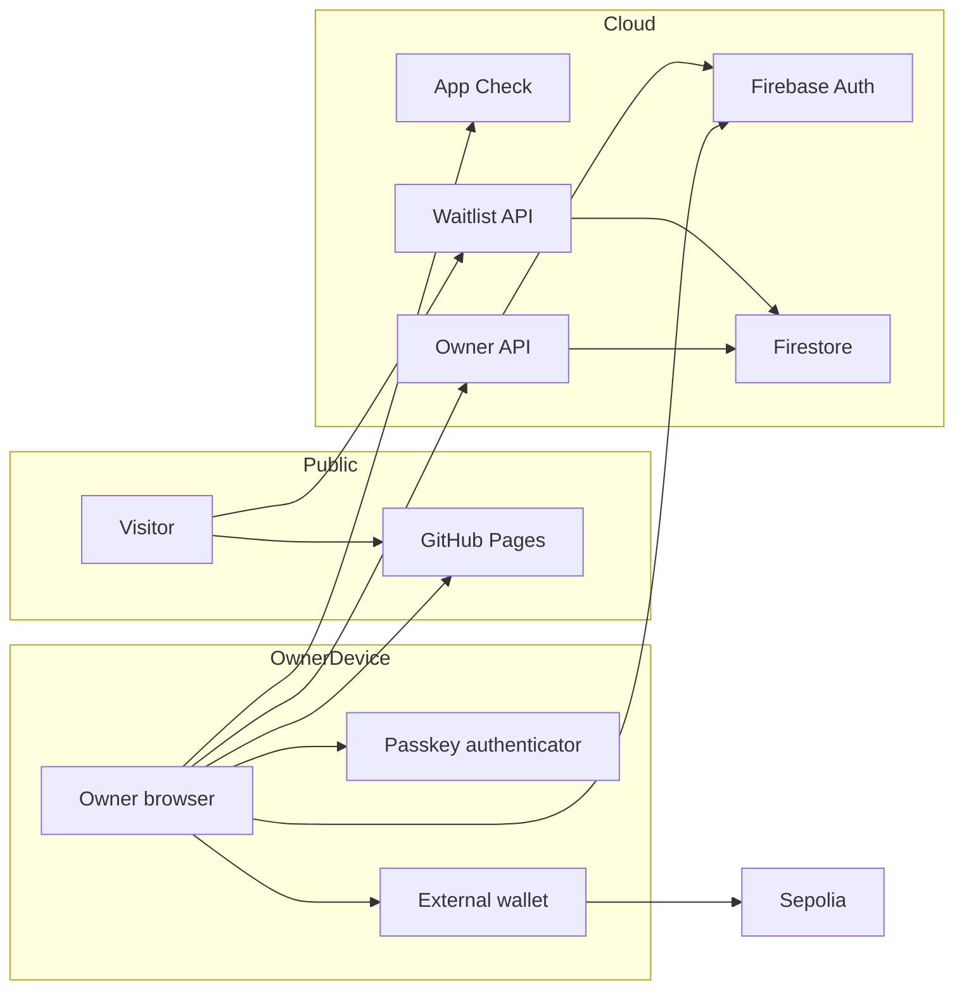

## Executive summary

The current system is a public waitlist and an owner-only Ethereum testnet workspace. Its most valuable assets are the owner session, passkey registrations, waitlist emails and the integrity of wallet-signing requests. Server authorization and one-use signed challenges protect the application boundary; the largest remaining risks are shared GitHub/Firebase trust domains, compromised wallet/browser/administrator identities, and untested hardware/public-network/recovery workflows. Public real-funds launch remains closed.

## Scope and assumptions

In scope: `owner.html`, `wallet-src/`, `wallet-assets/`, `public-site/`, `firebase-wallet/`, `firebase-waitlist/`, `_config.yml` and repository CI. The full dashboard in `wallet-src/dashboard/` is returned by the owner-authorized API and rendered in an opaque-origin iframe. It has no owner credentials or network permission; only narrowly validated UI navigation/activity messages reach the parent. Dashboard source and backend directories are excluded from Pages. Unrelated Firebase services, wallet firmware/provider internals, public chain consensus and legacy external hosting are outside this implementation review.

Context was checked with the owner: they delegated the recovery-model choice and supplied **FYNX finance world inc.** as the business name. This review uses these explicit assumptions:

- One verified owner can use the workspace; public users remain waitlisted.
- An external user-controlled wallet keeps the keys; FYNX does not collect recovery phrases.
- Only native Sepolia test ETH is supported; no customer real funds, fiat, swaps or custody are enabled.
- GitHub Pages and the existing Firebase project remain the deployment environment; other services must be preserved.
- The entity’s jurisdiction, launch markets, support staffing and legal/provider approvals were not supplied and are not assumed.

Open questions affecting risk: selected production wallet domain/project isolation; approved launch countries and user scale; exact supported hardware/mobile wallets; independently reviewed recovery and incident procedures. Expanding the above scope requires re-ranking this model.

## System model

### Primary components

GitHub Pages delivers static public/owner UI. Firebase Authentication issues account tokens after Google/email or verified passkey sign-in. reCAPTCHA Enterprise/App Check supplies app attestation. `fynxWalletWorkspace` verifies the owner and operates scoped Firestore collections. `joinFynxWalletWaitlist` stores consented registrations. An external EIP-1193 wallet supplies addresses, signatures and Sepolia RPC/transaction operations.

### Data flows and trust boundaries

- Browser → GitHub Pages: HTTPS requests for public, versioned UI/bundled code. Source is public; `_config.yml` excludes backend and private development directories. Source visibility never grants API access.
- Browser → Firebase Auth / Google: email/password or OAuth sign-in over HTTPS. ID/refresh tokens stay in SDK memory; the backend rechecks revocation, UID and verified email (`core.js:14`).
- Browser → reCAPTCHA / App Check: technical attestation data over HTTPS, domain-restricted public site key and Wallet app binding. This is app attestation, not user authorization (`index.js:11`, `core.js:7`).
- Browser → owner API: HTTPS callable with Auth and App Check tokens, exact origin, bounded JSON and action-specific validation. Anonymous passkey entry points are rate limited; privileged actions require owner authorization.
- Browser ↔ authenticator: WebAuthn registration/assertion, RP/origin binding, required user verification and server one-use challenges. Only public credential material reaches Firestore (`passkeys.js`).
- Owner API → Firestore: runtime IAM identity, fixed collection paths, transactional challenge consumption, timestamps and TTL. Existing project administrators retain their existing rules access; anonymous/non-admin client reads/writes are denied.
- Browser ↔ wallet: EIP-6963 discovery/EIP-1193 requests. Addresses and signatures are untrusted until validated. Network/account checks precede signatures and transfers; wallet keys stay outside FYNX (`wallet-client.js`).
- Wallet → Sepolia: provider RPC broadcasts user-approved native transfer, then receipt queries. Pending, failed and mined states differ. Provider correctness and chain consensus are external dependencies.
- Maintainer → GitHub / Firebase deployment: authenticated operator and CI/build tools can change code/runtime policy. Functions deploy by exact codebase/name; no repository credential is needed.

#### Diagram

## Assets and security objectives

| Asset | Why it matters | Security objective (C/I/A) |
| --- | --- | --- |
| Owner session / passkey public registrations | Grants privileged waitlist and wallet-link operations | C/I/A |
| Wallet-signing request | Wrong recipient/network/message can mislead the signer | I |
| Wallet keys and recovery words | Their loss/compromise controls the wallet | C/I; remain outside FYNX |
| Waitlist email/consent metadata | Personal information and consent evidence | C/I/A |
| Challenges and authorization state | Prevents replay/account confusion | I/A |
| Source/build/deployment identity | Determines every downstream control | I/A |
| Audit and retention records | Supports investigation and deletion handling | C/I/A |

## Attacker model

### Capabilities

An internet attacker can call public endpoints, bypass frontend UI, modify JSON/signatures, replay captured public proofs, create an ordinary Firebase account, submit waitlist addresses, automate requests and operate an Ethereum account. A malicious wallet extension can return false RPC data or alter its own UI. A compromised collaborator/dependency can attempt to change a deployed page. An existing privileged Firebase administrator can access data under existing project policy.

### Non-capabilities

The ordinary internet attacker is not assumed to control the owner’s Google account, private passkey, wallet key, GitHub account or Firebase IAM. Valid ECDSA/WebAuthn signatures cannot be forged under those assumptions. App Check does not make attackers impossible and is not assumed to establish identity.

## Entry points and attack surfaces

| Surface | How reached | Trust boundary | Notes | Evidence |
| --- | --- | --- | --- | --- |
| Public waitlist form/callable | Website or HTTP | Internet → backend | Consent/email normalization, stable doc ID, App Check | `public-site/app.js`, `firebase-waitlist/functions/index.js` |
| Google/email owner sign-in | Owner page | Browser → Auth | Existing owner only at backend; no public signup UI | `wallet-src/app.js:110`, `core.js:14` |
| Anonymous passkey endpoints | Callable | Internet → auth verifier | Challenge and signature required; rate limited | `index.js:22`, `passkeys.js:42` |
| Owner session/waitlist actions | Callable | Auth user → privileged data | UID, verified email, revoked token; deletion needs recent login | `index.js:26` |
| Wallet challenge/verify | Callable and wallet | Wallet → backend | Fixed chain/domain/message; one-use nonce | `core.js:29`, `index.js:37` |
| Transfer/receipt operations | Browser wallet RPC | Browser → wallet/chain | Native test ETH; fixed transaction fields; explicit review | `wallet-client.js:41` |
| GitHub Pages sibling paths | Same host | Other page → same origin | RP/path isolation unavailable | `functions/config.js`, `owner.html:5` |
| Build/deploy credentials | GitHub/Firebase tooling | Maintainer → runtime | Lockfiles, pinned CI actions, scoped deploy | `.github/workflows/verify.yml`, `firebase-wallet/firebase.json` |

## Top abuse paths

1. Read registrations → call owner action with an ordinary Firebase identity → owner UID check denies it; shared admins remain privileged by design.
2. Hijack a wallet link → replay another valid signature → consumed or UID-bound server challenge rejects reuse.
3. Forge owner passkey login → alter client data/origin or sign with another key → required WebAuthn verification and exact RP/origin reject it.
4. Steal an owner session → inject a script via a compromised sibling page/dependency → attempt privileged API calls; dedicated-origin/independent review remains a production gate.
5. Change a transfer → wallet account/network changes after review → event invalidation and pinned `from`/`chainId` stop stale approval; malicious wallet software remains outside the app’s control.
6. Exhaust resources → automate attested passkey/waitlist requests → quotas, rate limits and instance caps reduce impact; distributed abuse still requires monitoring.
7. Compromise deployment identity → ship modified signing code or extract shared-project data → repository/IAM hygiene and independent release review are required.
8. Misrepresent readiness → treat local EVM or virtual passkey tests as hardware/mainnet proof → explicit evidence labels and closed public launch prevent unsupported launch claims.

## Threat model table

| Threat ID | Threat source | Prerequisites | Threat action | Impact | Impacted assets | Existing controls (evidence) | Gaps | Recommended mitigations | Detection ideas | Likelihood | Impact severity | Priority |
| --- | --- | --- | --- | --- | --- | --- | --- | --- | --- | --- | --- | --- |
| TM-001 | Internet user | Ordinary Firebase account or no account | Call privileged session/waitlist actions | Personal-data exposure/control | Waitlist, owner session | `core.js:14` verifies token revocation, owner UID and email | Existing admins intentionally retain rights | Keep explicit owner gate; test every new action | Denial-rate alerts; IAM review | Low: live denial checks and server gate | High: private data affected | medium |
| TM-002 | Replay attacker | Captured signature/challenge | Reuse or bind proof to another user | Wrong wallet association | Wallet link, authorization | UID/domain/chain binding, five-minute expiry, atomic consume (`core.js`) | Hardware/contract-wallet behavior untested | Retain EOA-only scope; hardware review | Replay-denial metrics without signatures | Low: single-use server state | High if bypassed | medium |
| TM-003 | Phisher / sibling-page attacker | Control of another page on same GitHub origin; owner interaction | Solicit an RP-valid passkey assertion or inject origin code | Owner session compromise | Passkeys, waitlist | WebAuthn required UV and exact origin (`passkeys.js`) | Origin covers all sibling paths | Dedicated production domain; re-enroll RP; header controls | Origin/source integrity checks and release review | Medium: shared origin is real, exploit not demonstrated | High | high |
| TM-004 | Malicious wallet / compromised browser | Owner installs/uses compromised wallet software | Present false data or misleading signing prompt | Misleading approval or transfer | Wallet request integrity | Explicit UI review, chain pinning, wallet-side approval (`wallet-client.js`) | Cannot secure an already compromised signer | Device acceptance, supported-wallet list, independent review | Independent explorer verification; user reports | Medium: external component trust | High for a future funded wallet | high |
| TM-005 | Runtime/admin attacker | Compromise of runtime or privileged project user | Access shared Firestore/Auth scope | Cross-product data/account compromise | Shared project, owner data | Dedicated identity; scoped code paths (`SETUP.md`) | IAM datastore scope and Auth custom-token authority remain project-level | Dedicated production project; least-privilege operator review | IAM/token/audit anomalies | Low absent privileged compromise | High blast radius | medium |
| TM-006 | Distributed bot | Attested requests or many client origins/IPs | Consume invocation/database quotas | Outage/cost | Availability, budget | Rate limits, instance caps, App Check (`core.js:62`) | No staffed alerts/edge DDoS protection | Configure/test alerts and platform controls | Billing/quota/error-rate alerts | Medium: public endpoints | Medium | medium |
| TM-007 | Supply-chain/maintainer attacker | Modified dependency, workflow or source credential | Deploy altered auth/signing logic | Defeat app controls | Code integrity, sessions | Locks, bundle reproducibility, audit, pinned actions | Independent release review absent | Protected branches and review workflow; secret scanning | CI diffs; deployment identity logs | Low with current owner scope | High | medium |
| TM-008 | Operational mistake | Missing support/restore/device rehearsal | Lose access, miss deletion or launch prematurely | Availability/privacy loss | Records, recovery, trust | Readiness gates, TTL, operations procedures | Jurisdiction/staffing/drills unresolved | Complete review record, restore and alert drills before launch | Evidence checklist review | Medium: remaining work explicit | Medium | medium |

## Criticality calibration

Critical would mean unauthenticated takeover of the owner account, a practical private-key disclosure, or server-triggered real-funds theft. No such path was demonstrated here. High includes practical owner-session phishing on a shared origin, a deployed signer that changes recipients, or opening real funds before recovery/hardware validation. Medium includes shared-runtime blast radius requiring an existing compromise, distributed quota abuse, and missing tested alert/restore procedures. Low includes cosmetic error wording, a stale non-sensitive display, or compatibility gaps that fail closed without signing. Severity changes if public users, mainnet, fiat or custody enter scope.

## Focus paths for security review

| Path | Why it matters | Related Threat IDs |
| --- | --- | --- |
| `firebase-wallet/functions/core.js` | Owner token validation, challenges, rate limits | TM-001, TM-002, TM-006 |
| `firebase-wallet/functions/passkeys.js` | WebAuthn verification and custom-token issuance | TM-001, TM-003, TM-005 |
| `firebase-wallet/functions/index.js` | Every action’s authorization and data scope | TM-001, TM-005 |
| `wallet-src/wallet-client.js` | Chain/account checks and exact transfer fields | TM-002, TM-004 |
| `wallet-src/app.js` | Session lifecycle, async state and user approval | TM-003, TM-004 |
| `owner.html` | CSP and browser trust boundaries | TM-003 |
| `firebase-waitlist/functions/index.js` | Consent, duplicate handling, private records | TM-001, TM-006 |
| `.github/workflows/verify.yml` | Build/dependency integrity | TM-007 |
| `docs/OPERATIONS.md` | Detection, recovery and deletion practices | TM-008 |

## Notes on use

Coverage check: all discovered runtime entry points and trust boundaries are represented; maintainer/CI risks are separated from internet threats; owner clarifications and missing jurisdiction information are explicit; proposed production isolation and independent acceptance remain open questions. This model records this revision’s evidence, not permanent safety or regulatory approval.

## Dashboard isolation update — October 17, 2026

The `dashboard` API operation runs after the existing App Check, exact-origin, revoked-token and verified-owner checks. No standalone dashboard HTML is published by Pages. Public GitHub source is still visible and can be copied; the security boundary protects the deployed owner experience and private data, not source secrecy.

The iframe sandbox permits scripts, downloads and user-opened external links, but not same-origin, forms or top navigation. An exact script hash is present in both document and parent CSP; `connect-src none` blocks preview network calls. Inline styles are allowed for existing chart/layout attributes, with no `unsafe-inline` script or eval permission. All sample state is in memory. Sign-out removes the iframe, and a session generation check discards late responses. Parent message handlers verify the actual frame window and its opaque origin, and accept only fixed UI signals.
